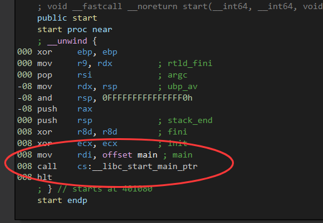
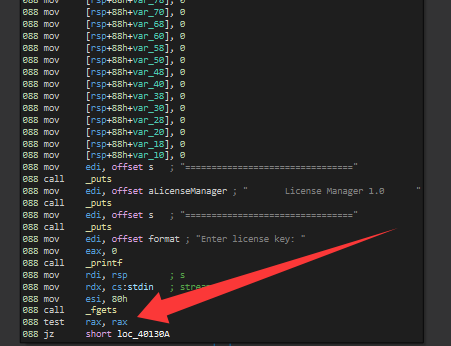
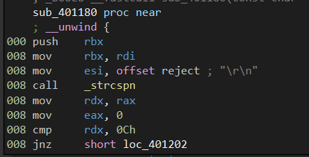
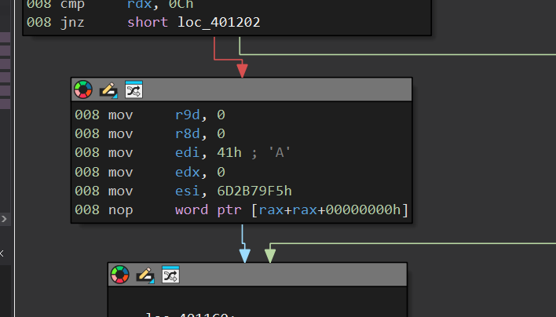
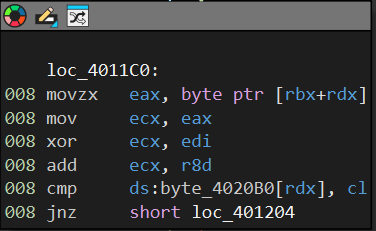
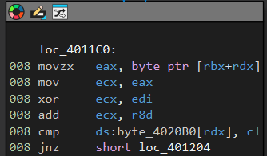
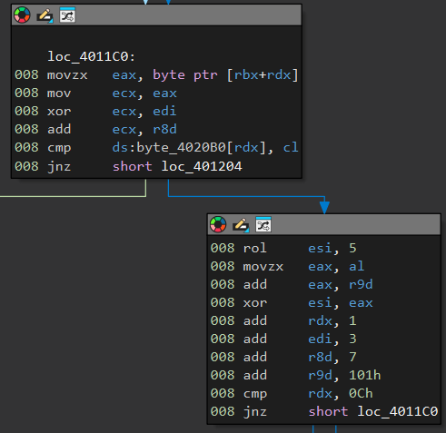
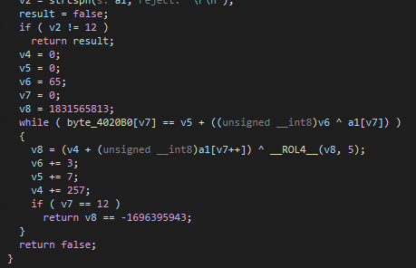

# 题目0001

我是一个老白，脑子很老，操作很小......

题目文件：`./1`（Linux x86-64 ELF，stripped，与本篇同目录）



```
start
  │
  └── 把 main 的地址交给启动函数
          │
          └── 由运行库完成初始化并调用 main
                    │
                    └── 开始执行主要程序逻辑
```

所以我们没有直接看到main，要从左侧找程序入口（鸡毛的，刚开始学，找了半天没找到程序入口，小尴尬）

（**`offset s`**：代表符号 `s` 在内存中的**地址** ）



前面一堆没用的，到这才开始判断用户输入是不是空。后面call了sub_401180这个函数，判断逻辑应该在这里（_fgets有读取输入）

小细节：**`rax` 里放的是什么？** ：`rax` 是**返回值**。对于 `_fgets` 来说，如果读取成功，它返回的是**缓冲区的首地址（也就是你传进去的那个指针）**；如果读取失败或到了文件末尾，它返回 **`NULL`（也就是 `0`）**。



我们找到了关键函数，但是看着有点懵逼：strcmp是字符串比较、strcspn大概理解为切割字符（自己查）。所以现在是这么个情况：

```
RDI = 输入字符串地址
ESI = "\r\n" 的地址
          │
          ▼
      strcspn()
          │
          ▼
      RAX = 字符数量
```

所以这一步` 008 cmp    rdx, 0Ch ` 就是比较你输入的字符长度是不是12位。不等于 12，就跳到地址 401202 去执行。



接着我到了这一步，woc这一步就很sao了，我之前没看懂。查了一下："edx 是 rdx 的低 32 位。在 64 位模式下，向 edx 写入数值会自动把 rdx 的高 32 位清零"。前面溯源一下： input -- rax -- rdx -- NOW，所以现在应该就是用户输入的前一半全成0了？

还有这个 nop 这个操作，看着叼叼的，就及吧是cpu空转，没用，直接跳过



（**进入 `main` 时**：`EDI` 对应第一个参数 `argc`，表示参数数量。不是 main 不算）
现在要确定 rbx 和 rdx 都是啥。找一下：rbx -- rdi -- rsp ，所以现在 rbx 放的是。。。。。。。（找一下）

```80x86
mov     rdi, rsp          ; 【参数1】把 rsp (栈顶地址) 给 rdi (对应 buffer)
mov     rdx, cs:stdin     ; 【参数3】把标准输入流给 rdx (对应 stream)
mov     esi, 80h          ; 【参数2】把 0x80 (也就是 128) 给 esi (对应 maxCount)
call    _fgets            ; 读取用户输入。读到的就在 rsp 寄存器所指的那块内存地址里

; --- 检查结果 ---
test    rax, rax          ; 看看 rax 是不是 0 (是否读取成功)
jz      short loc_40130A  ; 如果是 0 (失败/没输入)，跳转到 loc_40130A

```

**读到的就在 rsp 寄存器所指的那块内存地址里**       ---------   （刚长脑子）



循环准备开始。（相同的数异或，结果为 0）

- ```
  - `rdx` = `0x11223344_55667788`
  - `edx` = `0x55667788` （去掉了高 32 位）
  - `dx` = `0x7788` （去掉了高 48 位）
  - `dl` = `0x88`
  - `dh` = `0x77`
  ```



非常之烧脑的加密算法：

- **`rdx`** ：从0到12每次加1，读内存的一个字符（用来作比较）、顺序读输入的不同位置字符（说的太抽象了，懂我意思）
- **`rbx`**：输入字符串基址。指向你输入的那串密码的首地址

- **`edi`**：密钥 1。初始值 `0x41` ('A')，每次循环 `+3`。用于与字符进行异或。
- **`r8d`**：偏移量。初始值 `0`，每次循环 `+7`。异或完之后加上它。
- **`r9d`**：累加器。初始值 `0`，每次循环 `+0x101` (257)。用于更新 `esi`。
- **`esi`**：密钥 2 / 最终校验值。初始值 `0x6D2B79F5`。

大概说人话就是：

*   `i` = 循环索引，取值 `0` 到 `11` (即 `0xC`)。
*   `Input[i]` = 你输入的第 `i` 个字符（`[rbx+rdx]`）。
*   `Target[i]` = 预设密文数组的第 `i` 个字节（`ds:byte_4020B0[i]`）。

---

**1. 每一轮的校验公式（12轮必须全部相等）：**

`(Input[i] XOR (0x41 + 3 * i)) + (7 * i) == Target[i]`

---

**2. 每一轮的 `esi` 滚动更新公式：**

`esi = ( (esi ROL 5) XOR (Input[i] + 0x101 * i) )`

*初始值：`esi = 0x6D2B79F5`*

---

**3. 最终通关条件（12轮结束后）：**

`esi == 0x6A1B303B`

---


拿下！


我真是操了，md还有这好东西？有反编译早知道就不看汇编了。。。

