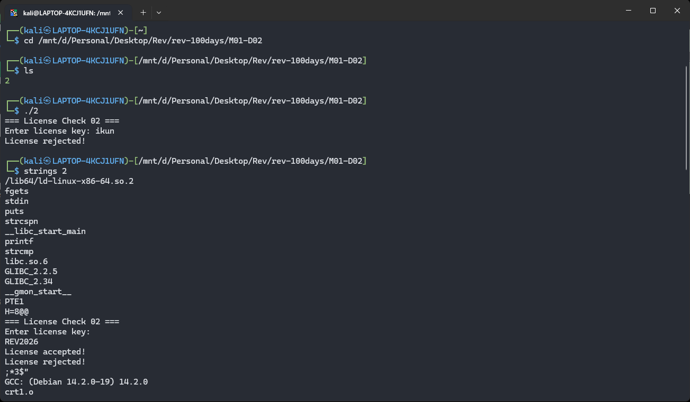
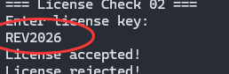
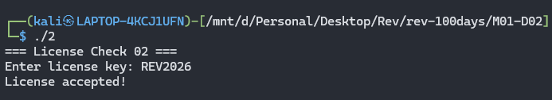
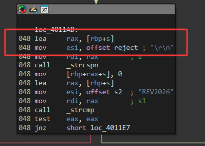
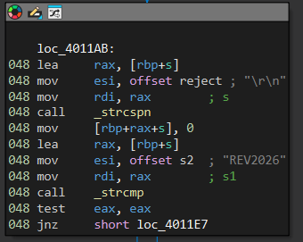

# 题目0002

题目文件：`./2`（Linux x86-64 ELF，未 strip，与本篇同目录）







今天这题目出的有水平，把我当弱智整？

看看ida吧：



截取到换行符之前



```
lea rax, [rbp+s]          ; 获取输入字符串地址
mov esi, offset reject   ; "\r\n"
mov rdi, rax
call _strcspn             ; 返回第一个换行符的位置
mov [rbp+rax+s], 0        ; 将该位置替换为 \0

lea rax, [rbp+s]          ; 获取处理后的输入
mov esi, offset s2       ; "REV2026"
mov rdi, rax
call _strcmp              ; 比较两个字符串
test eax, eax
jnz short loc_4011E7     ; 不相等则跳转
```

这个真没啥意思，还以为有坑。。。。。
