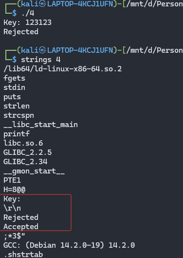
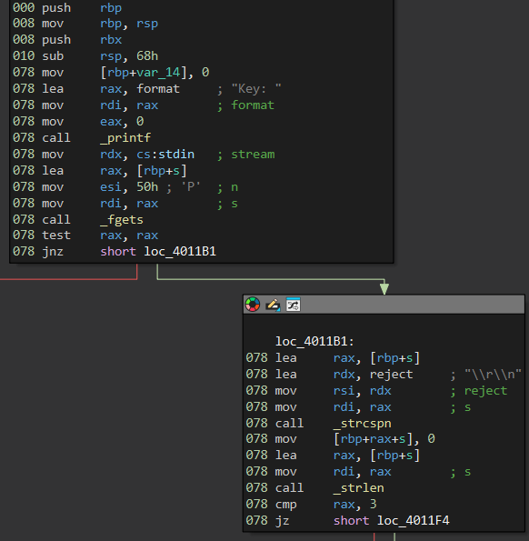
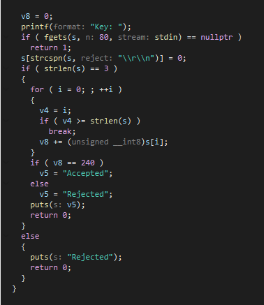
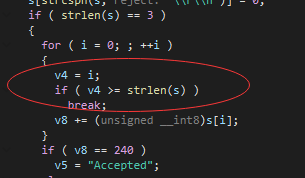
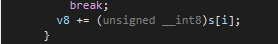
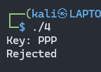
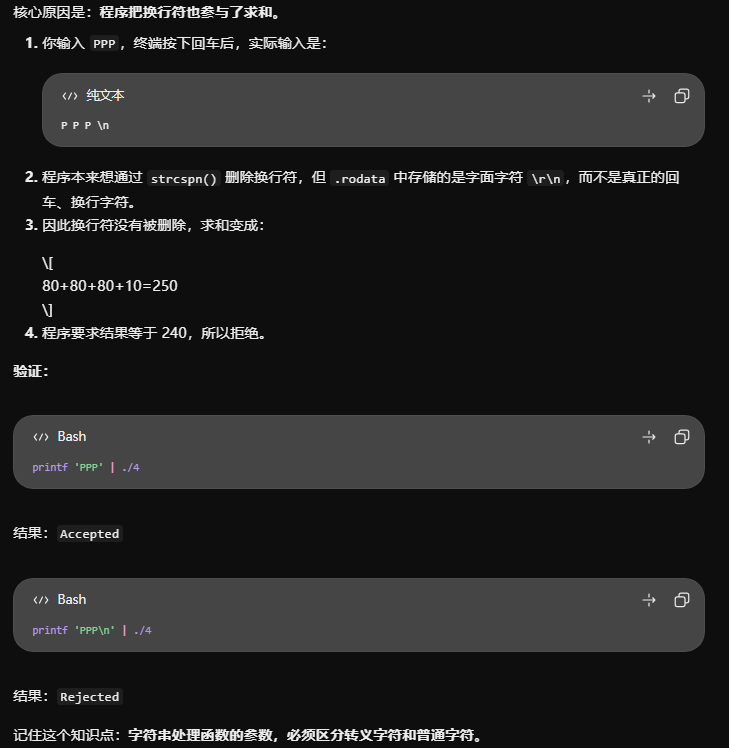
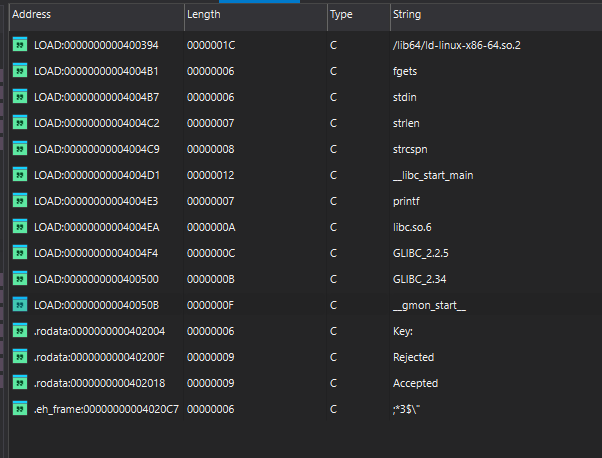
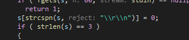
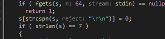

依旧strings起手，熟悉的分行，直接上ida

依旧熟悉的配方，输入字符串长度要为3

还是这个看着不烧心

一个循环。012执行3次。脑子有点短路了，这个没看懂：v8 += (unsigned __int8)s[i];这个s[i]是个啥。`s[i]` 代表的是用户输入的字符串中的第 `i` 个字符

那就很明显了：输入恰好3个字符，且这3个字符的 ASCII 码值之和必须等于 240

但是但是但是：

卧槽？？着为啥不行。P是80 。38240 。没毛病啊

66666666666666666666666666666666666666666666666666666我们看一下区别

| 类型             | 十六进制      | 实际含义        |
| ---------------- | ------------- | --------------- |
| 真正的换行符     | `0D 0A`       | `\r\n`          |
| 有坑的字面字符串 | `5C 72 5C 6E` | `\` `r` `\` `n` |

记住：

- `\r\n`：两个控制字符。
- `\\r\\n`：四个普通字符（在 C 字符串源码中表示字面量 `\r\n`）。

关键区别：`5C` 是反斜杠，`0D` 才是真正的回车。

牛逼出勤

拿下！

