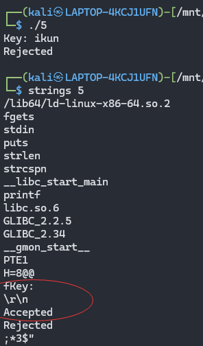
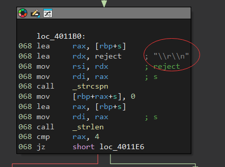
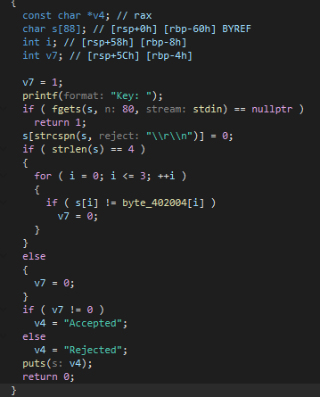
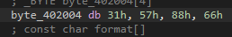
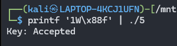

也没有用什么特殊的比较方法，可能是隐藏了



妈的又是这个

 

但是这一回的逻辑好像很简单。比较4位数，相等就行：

但是但是但是，又出现了新问题： **0x88 是非 ASCII 原始字节** ， 有一次脱离认知范畴了



学到了bro

```
printf '1W\x88f' | ./5
```

这里有四个字节：

| 写法   | 实际字节 | 含义         |
| ------ | -------- | ------------ |
| `1`    | 0x31     | 字符 1       |
| `W`    | 0x57     | 字符 W       |
| `\x88` | 0x88     | 十六进制字节 |
| `f`    | 0x66     | 字符 f       |

注意：`\x88` 并不是输出四个字符 `\x88`，而是输出一个值为 `0x88` 的字节。


卧槽有点东西

